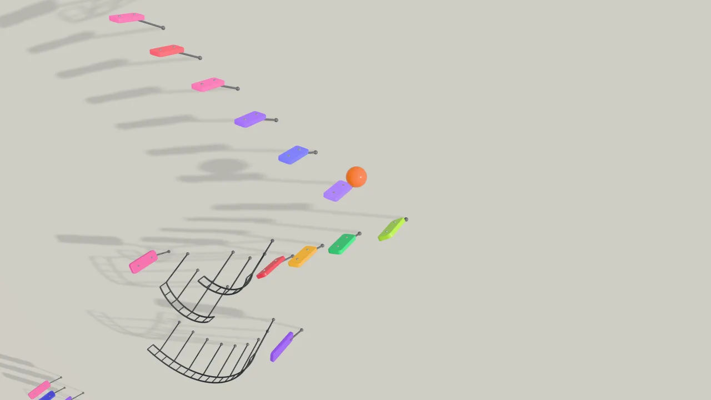
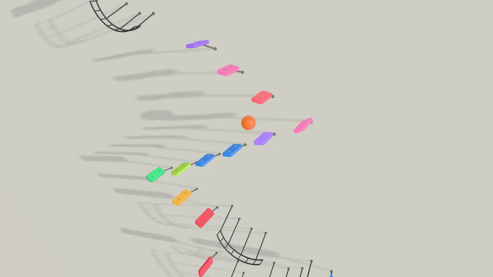
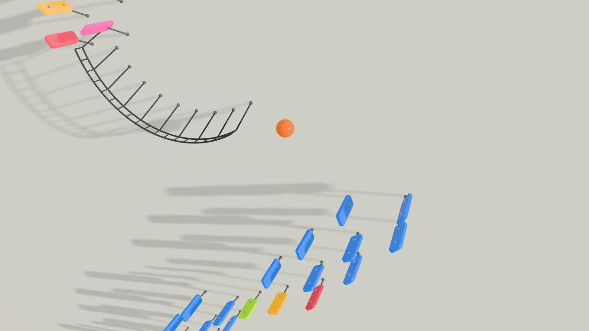
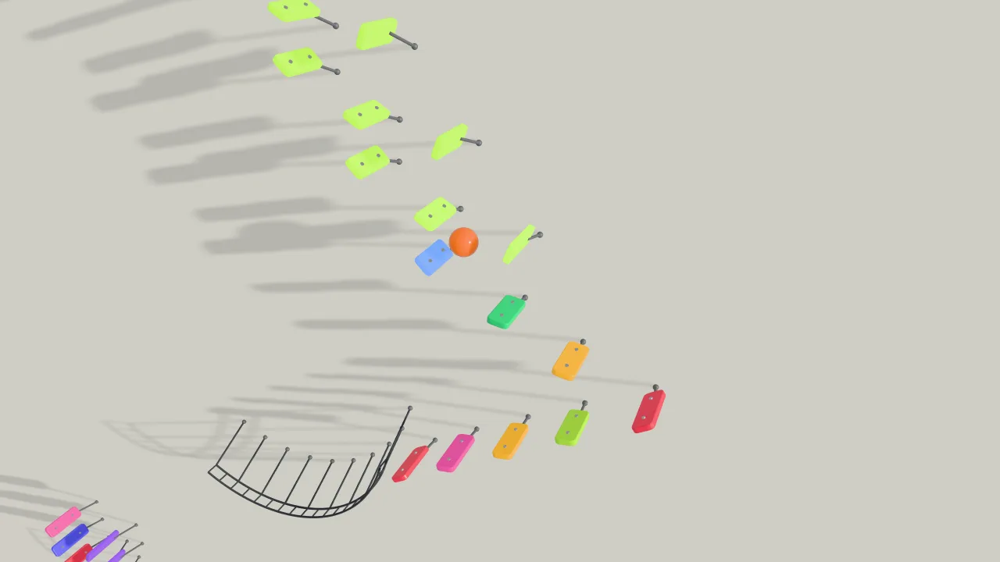

# Marble Loop

Una biglia arancione scende lungo un muro bianco, rimbalzando su tasti di xilofono piantati nel muro come chiodi:
zig-zag fra due colonne per le note veloci, scalette per quelle medie, mezzelune di filo per le pause. Ogni colpo è una
nota; il tasto colpito cede, si accende del suo colore e resta acceso. Il loop non ha fine: l'ultimo istante è il primo.

<table>
<tr>
<td width="50%"></td>
<td width="50%"></td>
</tr>
<tr>
<td width="50%"></td>
<td width="50%"></td>
</tr>
</table>

**Guardalo:** apri `index.html` (anche dal telefono, anche dentro un'app di chat) e scegli la musica dal menu: la
scelta accende il suono. Il pulsante **♪ Musica** in alto a destra riapre il menu. In alto a sinistra: fotogrammi al
secondo, il fotogramma più lungo e la risoluzione.

## Musica

- **Medley**: 241 note in un loop di 52 secondi, il *Rondò alla turca* di W. A. Mozart (Sonata K. 331), il *Galop
  infernal* di J. Offenbach e il finale dell'ouverture del *Guglielmo Tell* di G. Rossini.
- Ognuno dei tre da solo, in loop.
- ***The Entertainer*** di S. Joplin, il primo tema, in loop.

Un brano si apre anche dall'indirizzo: `index.html#rondo`, `#galop`, `#tell`, `#entertainer`.

Tutto è generato nel browser: la scena con three.js, i suoni con Web Audio. Nessun file esterno.

## Crediti

- [three.js](https://threejs.org) r186, licenza MIT
- Musiche di pubblico dominio, trascritte e semplificate
